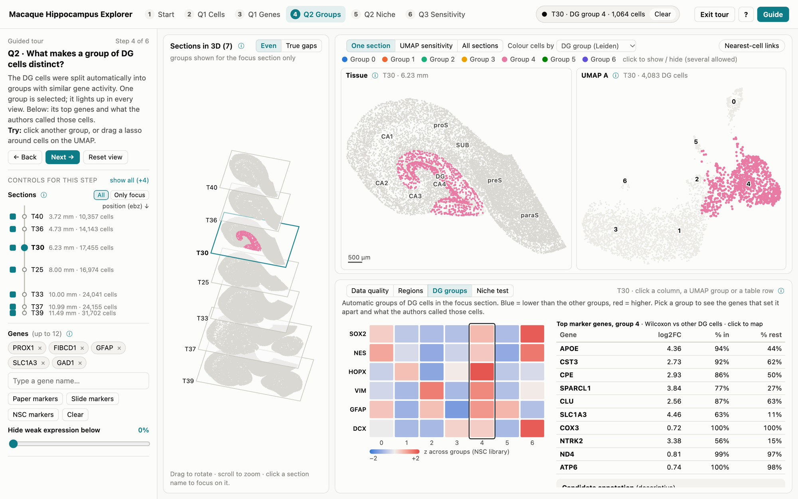

# SpatiOmicsVis — Macaque Hippocampus Explorer

**Interactive visual analytics for spatial transcriptomics in the macaque hippocampus.**

SpatiOmicsVis explores approximately **139,000 cells across seven Stereo-seq tissue sections** from one adult macaque hippocampus (Fei et al., 2026). It connects tissue anatomy, gene expression, cell-type composition, dentate gyrus (DG) cell groups, spatial-neighborhood analyses, and UMAP reliability in a browser-based interface. The six-step guided tour is designed for neuroscientists and other users without programming experience.



**[Read the illustrated two-page explorer guide (PDF)](Explorer_Guide.pdf)** · **[View the HTML guide](guide.html)** · **[Open the guided explorer](index.html)** · **[Open free exploration](explore.html)**

> The linked HTML files are part of the downloaded repository. To use the interactive explorer, follow the local setup instructions below rather than expecting GitHub's file preview to run it.

## Quick start

1. Select **Code → Download ZIP** on GitHub, then **extract the entire folder**. Keep its files and subfolders together; do not launch HTML files from inside the ZIP.
2. Open one of these files in **Google Chrome**:
   - **`index.html` (recommended):** guided tour with six short steps.
   - **`explore.html`:** all exploration controls available immediately, without the tour.
3. Allow a few seconds for the precomputed cell data to load.

No package installation, programming, or internet connection is needed for normal local use. Google Chrome has been tested; other modern browsers may work but have not been verified.

**If the page is blank or stuck at “Loading cells…”:** ensure the complete folder has been extracted and nothing was moved. If your browser blocks local file access, start the included local server from the repository folder (requires Python 3):

```bash
python3 serve.py
```

Then visit **http://localhost:8765**. On Windows, `python serve.py` may be needed instead of `python3 serve.py`.

## Research questions

The explorer organizes the analysis around three questions:

1. **Where are cells and genes?** How do cell-type composition and regional marker patterns vary across hippocampal subregions and tissue sections?
2. **What distinguishes DG cell groups, and is there evidence of a neural stem-cell niche?** Can clustering, marker expression, and spatial proximity help evaluate candidate neural stem-cell-like populations?
3. **How reliable are the UMAP representations?** Do the embeddings preserve local gene-expression neighborhoods, and which cell positions may be misleading?

## Explore the interface

| View or control | What it does |
| --- | --- |
| **3D section stack** | Displays seven sections ordered by sampled position; drag to rotate and select a section to focus. |
| **Tissue map** | Shows cells at their measured locations within the focused section. |
| **UMAP** | Places DG cells with similar gene-expression profiles near one another in two dimensions; **UMAP coordinates are not anatomical coordinates**. |
| **Evidence panel** | Displays question-specific charts and tables, including cell-type composition, marker comparisons, clustering summaries, and spatial-neighborhood results. |
| **Colour cells by** | Changes coloring across linked views (for example, region, cell type, or gene expression). |
| **Sections / Only focus** | Includes or excludes sections; isolates a single section for closer inspection. |
| **UMAP sensitivity** | Compares embedding settings, highlights potentially misleading positions with red rings, and provides a true-neighbor lens. |
| **Legend and selection tools** | Show/hide multiple categories and select cells for linked displays and charts. |

Hover a cell to inspect it and highlight its counterpart in the linked view. Click a group or use the lasso to select cells; click legend entries to show or hide groups, then **Select these cells** to use those groups in the evidence panel. Scroll to zoom, choose **Pan** to move around, and press **Esc** to clear the selection. Use **← / →** to navigate tour steps. Hover over information icons for explanations.

### Six-step guided tour

| Step | Focus | What to explore |
| --- | --- | --- |
| **1. Start** | Data and quality | Section summary, quality histograms, and quality-control coloring. |
| **2. Q1 · Cells** | Regional cell types | Compare DG and CA1 cell-type proportions across sections. |
| **3. Q1 · Genes** | Spatial marker expression | Compare marker-gene patterns by region and section; follow a gene across the 3D stack. |
| **4. Q2 · Groups** | DG cell populations | Explore Leiden groups, stem-cell marker heatmaps, group labels, and top genes. |
| **5. Q2 · Niche** | Spatial neighborhoods | Compare proximity to astrocytes against a chance baseline, including comparisons restricted to astrocytes. |
| **6. Q3 · Sensitivity** | Embedding reliability | Compare UMAP settings and inspect cells whose apparent neighbors may be misleading. |

Choose **Exit tour** for unrestricted exploration; **Start tour** reopens the walkthrough. The **Guide** button opens the illustrated reference sheet.

## Summary of findings

These findings are **exploratory analyses of public data**. They describe the selected sections and should not be interpreted as proof of a particular cell identity or biological mechanism. For methods, figures, and supporting interpretation, see **[Explorer_Guide.pdf](Explorer_Guide.pdf)**; for the stored numerical results, see **[`data/findings.json`](data/findings.json)**.

### Q1 — Hippocampal subregions retain distinct cellular and marker profiles

- Known regional markers showed consistent enrichment across all seven sections: **PROX1** in DG (approximately 6–13×), **FIBCD1** in CA1 (8–23×), **HOMER3** in CA3/CA4 (2–5×), and **NTS** in the subiculum (6–41×). Because expression contributed to the original region definitions, these are consistency checks, not independent validation.
- DG contained approximately **62% glutamatergic neurons**, compared with **42% in CA1**. CA1 had more oligodendrocytes (**18% versus 5% in DG**).
- **GFAP** expression was higher in DG, whereas **SLC1A3** was higher in CA1 across the seven sections. This regional difference motivates further study, but does not establish astrocyte specialization.
- **Important technical caveat:** expression levels across different sections track sequencing depth (median correlation **ρ ≈ 0.79** across 200 genes). Comparisons within sections are more defensible than uncorrected long-axis expression gradients.

### Q2 — DG clustering identifies major cell classes, but not a confirmed neurogenic niche

- Automated DG clustering produced **3–7 groups per section**, generally recovering recognizable astrocyte, neuronal, and other cell populations.
- Rare progenitor markers were sparsely detected. The high-scoring **“NSC-like”** population represented approximately **0.5–1.9%** of DG cells, and **85–96%** of these cells already had published astrocyte labels.
- Apparent proximity between NSC-like cells and astrocytes was stronger than chance when compared against **all DG cells**, but **not significant after multiple-testing correction when compared against other astrocytes**. This does not provide evidence of a distinct stem-cell niche.
- Low transcript capture and sparse marker detection limit the ability to resolve rare progenitor populations. **Not detecting these cells is not evidence that adult neurogenesis is absent.**

### Q3 — UMAP is broadly stable, with caution for small groups

- The scDEED analysis flagged approximately **0.3–0.6%** of DG cells per section as potentially misleading in the examined embeddings.
- The two assessed UMAP settings (`min_dist = 0.1` and `0.5`) performed similarly overall, but did not flag exactly the same cells.
- Smaller groups showed a higher rate of dubious positions (**approximately 1.3–2.3%** in the reported comparisons versus **~0.3%** in large groups). Inspect isolated or small UMAP clusters carefully before assigning biological significance.

## Dataset and analytical context

The source dataset is from **Fei et al. (2026)** and comprises spatially resolved Stereo-seq measurements from a macaque hippocampus. This explorer uses **seven of 30 sampled sections** from **one animal**, rather than a multi-animal cohort. The selected section identifiers are `T40`, `T36`, `T30`, `T25`, `T33`, `T37`, and `T39`.

The analyses presented in the guide include cell-type composition, regional gene-expression comparisons, **Leiden** grouping of DG cells, an exploratory neural stem-cell (NSC) marker score based on **SOX2, NES, HOPX, VIM, GFAP, and DCX**, spatial-neighborhood comparisons against randomized labels, and **scDEED** embedding-sensitivity diagnostics. Much of the data and analysis output is precomputed for interactive browsing.

**Interpretation limits:** This project uses a single animal, uneven sequencing depth across sections, and inferred cell identities. The guide also identifies outstanding confirmation of spatial coordinate scale and anterior–posterior orientation. True 3D tissue registration and sequencing-depth-adjusted cross-section comparisons remain future work. The displayed 3D stack is a section-position overview, not a validated 3D cell reconstruction.

## Repository structure

```text
project-SpatiOmicsVism/
├── README.md               # Project overview and instructions
├── index.html              # Explorer with six-step guided tour
├── explore.html            # Explorer without guided tour
├── Explorer_Guide.pdf      # Illustrated two-page guide and scientific findings
├── guide.html              # Web version of the guide
├── guide_screenshot.png    # Screenshot used by the guide and README
├── serve.py                # Optional local server
├── style.css               # Interface styling
├── data/                   # Precomputed data and analytical outputs
│   └── findings.json       # Quantitative findings referenced in the guide
├── js/                     # Application scripts
└── vendor/                 # Bundled supporting libraries
```

**Keep `data/`, `js/`, and `vendor/` in place.** The explorer depends on their relative paths to load correctly.

## References

**Primary dataset**

Fei, T., Dong, Y., Gou, X., et al. (2026). *Evolutionary convergence and divergence of hippocampal cytoarchitecture between rodents and primates revealed by single-cell spatial transcriptomics.* **National Science Review, 13**(5), nwaf595. https://doi.org/10.1093/nsr/nwaf595

The [explorer guide](Explorer_Guide.pdf) also cites supporting work on adult neurogenesis, UMAP, Leiden clustering, spatial analysis, and scDEED embedding reliability.

## Authors

**Nicolle Bejarano** and **Zhihao Chen**  
Biomedical Visual Analytics · New York University (NYU) · Fall 2026

*Academic research and visualization project; results are descriptive and exploratory.*
