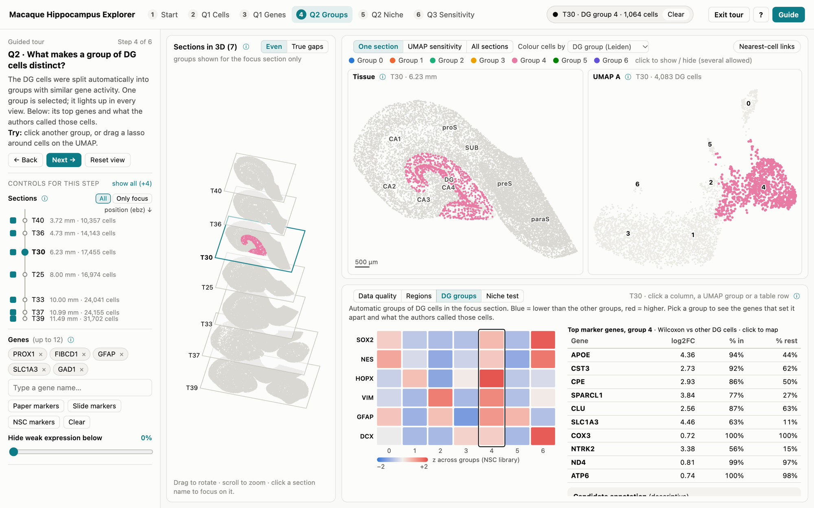

# SpatiOmicsVis — Macaque Hippocampus Explorer

**An interactive visual analytics explorer for macaque hippocampus spatial transcriptomics.**

SpatiOmicsVis connects tissue anatomy, gene expression, cell-type composition, dentate gyrus (DG) cell groups, spatial-neighborhood analysis, and UMAP reliability. It visualizes **138,827 cells across seven Stereo-seq tissue sections** from one macaque hippocampus (Fei et al., 2026). A six-step guided tour introduces the scientific questions; free-exploration mode provides access to all controls.



**Documentation:** [Illustrated two-page guide (PDF)](Explorer_Guide.pdf) · [HTML guide](guide.html)  
**Entry points:** [`index.html`](index.html) (guided tour) · [`explore.html`](explore.html) (free exploration)

> **Important:** This repository contains a **local web application**, not a continuously hosted public website. GitHub's file preview does not run the application. Download and extract the project, then launch it on your own computer using the instructions below. A locally running server is accessible on **your computer only** and stops when you close the terminal or shut down the computer.

## 1. Download the project

1. Open the [GitHub repository](https://github.com/nvb7705-tandon/project-SpatiOmicsVism).
2. Select **Code → Download ZIP**.
3. In Windows File Explorer, right-click the downloaded ZIP and choose **Extract All**. Select a permanent folder such as `Documents` or a project directory.
4. Open the **extracted** folder, not the ZIP preview or a temporary folder. Locate `index.html`, `explore.html`, and `serve.py` in the same directory, alongside `data/`, `js/`, and `vendor/`.

Do not move individual files out of their folders: relative paths are required for data and scripts to load.

## 2. Run locally (recommended: VS Code + Python)

This is the recommended method, including when a browser displays a blank page or gets stuck on **“Loading cells…”**.

**Requirements:** Python 3, a modern web browser (Google Chrome tested), and optionally Visual Studio Code (VS Code). There is no need to install Python packages or run a separate analysis pipeline just to use the explorer. After downloading the ZIP and installing Python, an internet connection is not required to run the included application.

### Windows / Visual Studio Code

1. Open **VS Code → File → Open Folder** and select the extracted folder containing `serve.py` and `index.html`. Do **not** open the ZIP or a temporary extraction path such as `AppData\Local\Temp\...`.
2. Open **Terminal → New Terminal**.
3. Verify that the project files exist in the folder:

   ```powershell
   dir
   ```

   You should see `index.html`, `explore.html`, and `serve.py`.
4. Start the included local server:

   ```powershell
   py serve.py
   ```

   If `py` is unavailable, try `python serve.py`. On macOS or Linux, use `python3 serve.py`.
5. Keep the terminal open. You should see a message similar to:

   ```text
   Serving ...\project-SpatiOmicsVism-main at http://localhost:8765  (Ctrl+C to stop)
   ```
6. Open Chrome and enter one of these addresses **directly into the address bar**:

   - **Guided tour:** http://localhost:8765/index.html
   - **Free exploration:** http://localhost:8765/explore.html

7. Allow a few seconds for the cell data and interactive views to appear. To stop the local server, return to the terminal and press **Ctrl+C**.

**How it works:** `serve.py` starts a Python HTTP server bound to `127.0.0.1` (your computer) on port `8765` and serves files from the directory containing `serve.py`. The browser accesses the explorer at `localhost`. It does **not** depend on a collaborator leaving their computer running, and it does **not** make the interface publicly available online.

### Alternative: open the HTML file directly

After fully extracting the project, you can try double-clicking `index.html` (guided tour) or `explore.html` (free exploration). Some browsers restrict local-file access and may fail to load data in this mode. If so, use the local server instructions above. Chrome is tested; Edge, Firefox, and Safari have not been fully verified.

## 3. Troubleshooting

| Symptom | Likely cause and fix |
| --- | --- |
| `404 File not found` for `/index.html` | The server is running, but it cannot find the file in the folder it serves. Re-extract the ZIP to a permanent folder; in VS Code, open the folder containing **both** `serve.py` and `index.html`, and restart the server. Check for an extra nested folder. |
| Server path contains `AppData\Local\Temp` | You may be running from a temporary ZIP extraction. Use **Extract All** and reopen the permanent extracted directory. |
| Blank page or “Loading cells…” | Confirm that `data/`, `js/`, and `vendor/` have not been moved; load the page through `http://localhost:8765/` rather than a `file://` URL. |
| `py` or `python` is not recognized | Install Python 3 and reopen the VS Code terminal; try the alternative command listed above. |
| Port `8765` already in use | Another server may still be running. Return to its terminal and press **Ctrl+C** before starting a new instance. |
| `favicon.ico` 404 in the terminal | A browser requested an optional site icon; this message does not prevent the explorer from working. |
| Someone else cannot open your `localhost` link | `localhost` refers to **their** computer, not yours. They must download the repository and run it locally, or the project must be deployed on a separate public hosting service. |

## 4. Research questions

1. **Where are cells and genes?** How do cell-type composition and regional gene-expression patterns vary across hippocampal subregions and sections?
2. **What distinguishes DG cell groups, and is there evidence of a neural stem-cell niche?** Can clustering, marker expression, and spatial proximity help evaluate candidate neural stem-cell-like populations?
3. **How reliable are the UMAP representations?** Which positions preserve local expression neighborhoods, and which may be misleading?

## 5. Explore the interface

| View or control | Purpose |
| --- | --- |
| **3D section stack** | Overview of the seven sampled sections; rotate and focus on a section. This is a schematic section stack, **not** a validated 3D cell reconstruction. |
| **Tissue map** | Cell positions within an individual tissue section. |
| **UMAP views** | Gene-expression similarity among DG cells; **UMAP coordinates do not represent physical tissue locations**. |
| **Colour cells by** | Coordinate coloring across linked views by selected attributes or gene expression. |
| **Sections / Only focus** | Include/exclude sections and isolate a selected section. |
| **Legend, lasso, selection** | Show/hide categories and select cells for linked charts. Press **Esc** to clear selection. |
| **Evidence panel** | Contextual plots and tables for QC, regions, groups, spatial neighborhoods, and embedding reliability. |
| **UMAP sensitivity** | Compare two UMAP settings and inspect reliability indicators, red rings, and the neighbor lens. |
| **Guide and tooltips** | Open the illustrated instructions and hover over information icons for definitions. |

### Six-step guided tour

| Step | Topic | Main activity |
| --- | --- | --- |
| 1 | Data and quality | Inspect section summaries and quality-control measures. |
| 2 | Q1: Cells | Compare DG and CA1 cell-type composition. |
| 3 | Q1: Genes | Examine marker-gene expression across regions and sections. |
| 4 | Q2: Groups | Inspect DG Leiden groups and stem/progenitor markers. |
| 5 | Q2: Niche | Explore spatial proximity and chance-baseline comparisons. |
| 6 | Q3: Sensitivity | Compare UMAP settings and identify potentially misleading embeddings. |

Use **Next** (or the arrow keys where supported) to advance through the guided tour. **Exit tour** opens free exploration, and **Start tour** restores the walkthrough. For further instructions and figures, see [Explorer_Guide.pdf](Explorer_Guide.pdf).

## 6. Data availability and processing

### What is included

The repository includes the **precomputed visualization data** needed to run the explorer: **138,827 cells**, a **200-gene visualization panel**, seven sampled sections (`T40`, `T36`, `T30`, `T25`, `T33`, `T37`, and `T39`), and saved analysis outputs. **You do not need to download raw Stereo-seq files or rerun preprocessing to launch the interface.**

- `data/cells.js` — packaged cell-level visualization data.
- `data/genes/` — packaged per-gene data for the explorer.
- `data/findings.json` — numerical results used in the guide.
- `data/pipeline_summary.json` — recorded processing settings and section summaries.

### Where to obtain the source data

Source: Fei, T., Dong, Y., Gou, X., et al. (2026), *National Science Review*, 13(5), nwaf595. https://doi.org/10.1093/nsr/nwaf595

For independent raw-data analysis, consult the article's **data availability statement** and its linked repository or archive. This project does not provide a verified direct raw-data download link. The visualization packages in `data/` are **processed outputs**, not a substitute for the full original Stereo-seq dataset.

### Recorded processing workflow

According to [`data/pipeline_summary.json`](data/pipeline_summary.json), the precomputed analysis used:

1. **Quality control:** median absolute deviation (MAD) threshold parameter `3.0`.
2. **Normalization:** counts per 10,000 followed by `log1p`.
3. **Feature selection:** 2,000 highly variable genes.
4. **Dimensionality reduction:** 20 principal components.
5. **Neighbor graph:** 15 nearest neighbors.
6. **DG grouping:** Leiden clustering at resolution `0.5`.
7. **Differential expression:** Wilcoxon test, DG cluster versus the remaining DG cells.
8. **UMAP reliability:** scDEED diagnostics; the interface compares UMAP `min_dist` values of `0.1` and `0.5`.

The summary records a random seed of `20261024`. The explorer also includes browser-side interaction and some spatial-neighborhood calculations. See the PDF guide and `js/stats.js` for the analysis presented in the interface.

**Reproducibility limitation:** This repository contains **processed datasets, application code, and processing metadata**, but **not the original raw-data preprocessing scripts or a complete executable environment for rebuilding the processed data from scratch**. The steps above describe recorded settings, not an independently verified end-to-end reconstruction procedure. Recreating all data products would require the original input data, preprocessing scripts, and dependency versions.

## 7. Summary of findings

These findings are **exploratory** and refer to the sampled sections. The detailed analysis, figures, interpretation, and citations are in [Explorer_Guide.pdf](Explorer_Guide.pdf); stored quantitative results are in [`data/findings.json`](data/findings.json).

### Q1 — Regional patterns

- Region-associated markers were enriched across the sampled sections: **PROX1** in DG, **FIBCD1** in CA1, **HOMER3** in CA3/CA4, and **NTS** in subiculum. These are consistency checks, not independent validation, because marker expression also informed the original region definitions.
- DG had a higher proportion of glutamatergic neurons than CA1 (about **62% versus 42%**), while CA1 had a higher proportion of oligodendrocytes (about **18% versus 5%**).
- **GFAP** was higher in DG, and **SLC1A3** higher in CA1, in the reported comparisons. Across-section expression is confounded by sequencing depth, so apparent long-axis gradients require caution.

### Q2 — DG groups and candidate stem-cell-like populations

- DG Leiden clustering produced **3–7 groups per section**.
- The high-scoring **“NSC-like”** candidates accounted for approximately **0.5–1.9%** of DG cells; most were already labeled astrocytes (**85–96%**). Rare progenitor markers were sparsely detected.
- Spatial proximity results did **not** establish a distinct neurogenic niche after comparison with other astrocytes and correction for multiple testing. **Failure to identify a niche is not evidence that adult neurogenesis is absent.**

### Q3 — Embedding sensitivity

- scDEED flagged about **0.3–0.6%** of DG cells per section as potentially misleading under the examined UMAP settings.
- The settings were similar overall, but flagged partly different cells. Small clusters warrant extra care in interpretation.

## 8. Scientific and technical limitations

- **Sampling:** Seven of 30 available sections from **one animal** are shown; results are not multi-animal population estimates.
- **Cell identity:** Published cell annotations and marker-score candidates are not experimentally confirmed identities; stem-cell-like scores do not prove neural stem-cell identity.
- **Sequencing depth:** Cross-section expression differences are vulnerable to variation in transcript capture and should not be interpreted as validated biological gradients.
- **Spatial reconstruction:** The 3D section stack is a visualization of section order, **not** a fully registered 3D tissue or cell reconstruction; spatial scale and anterior–posterior orientation require independent verification as noted in the guide.
- **UMAP:** Embedding distance is not anatomical distance, and clusters alone do not prove distinct biological cell types.
- **Server availability:** `serve.py` runs on the user's own computer. It is not an always-on public hosting service and must remain running while the browser loads project assets.
- **Browser compatibility:** Chrome has been tested; other browsers have not been comprehensively tested.
- **Reprocessing:** Complete raw-data preparation scripts and exact environment specifications are not distributed with this repository.

## 9. Repository structure and code organization

```text
project-SpatiOmicsVism-main/
├── README.md                  # Overview, setup, data, findings, limitations
├── index.html                 # Guided-tour entry point
├── explore.html               # Free-exploration entry point
├── Explorer_Guide.pdf         # Two-page illustrated instructions and findings
├── guide.html                 # Web version of the guide
├── guide_screenshot.png       # Screenshot
├── serve.py                   # Optional Python localhost server
├── style.css                  # Interface styles
├── data/
│   ├── cells.js              # Packaged cell data
│   ├── genes/                # Packaged gene data
│   ├── findings.json         # Stored analysis findings
│   └── pipeline_summary.json # Processing parameters and section summaries
├── js/
│   ├── core.js               # Data loading and shared application state
│   ├── main.js               # Main controls and rendering coordination
│   ├── scatter.js            # Tissue/UMAP scatter interactions
│   ├── stack3d.js            # Section-stack rendering
│   ├── encoding.js           # Shared color encodings
│   ├── charts.js             # Reusable chart components
│   ├── views.js              # Linked views and selections
│   ├── evidence.js           # Evidence panels
│   ├── stats.js              # Spatial statistics
│   ├── story.js              # Six-step tour configuration
│   └── help.js               # Tooltips and help text
└── vendor/
    └── d3.min.js             # Bundled D3 library
```

The application is primarily **HTML, CSS, and JavaScript**; `serve.py` serves its static files. The included data supports the interface without a Python backend or a separate running analysis service. Keep all directories and their relative paths intact.

## 10. Reference and authors

**Data source:** Fei, T., Dong, Y., Gou, X., et al. (2026). *Evolutionary convergence and divergence of hippocampal cytoarchitecture between rodents and primates revealed by single-cell spatial transcriptomics.* **National Science Review, 13**(5), nwaf595. https://doi.org/10.1093/nsr/nwaf595

**Developed by:** Nicolle Bejarano and Zhihao Chen  
**Course:** Biomedical Visual Analytics, New York University (NYU)  
**Semester:** Fall 2026

*Academic visualization project. Interpret all reported findings in the context of the methodological and sampling limitations above.*
